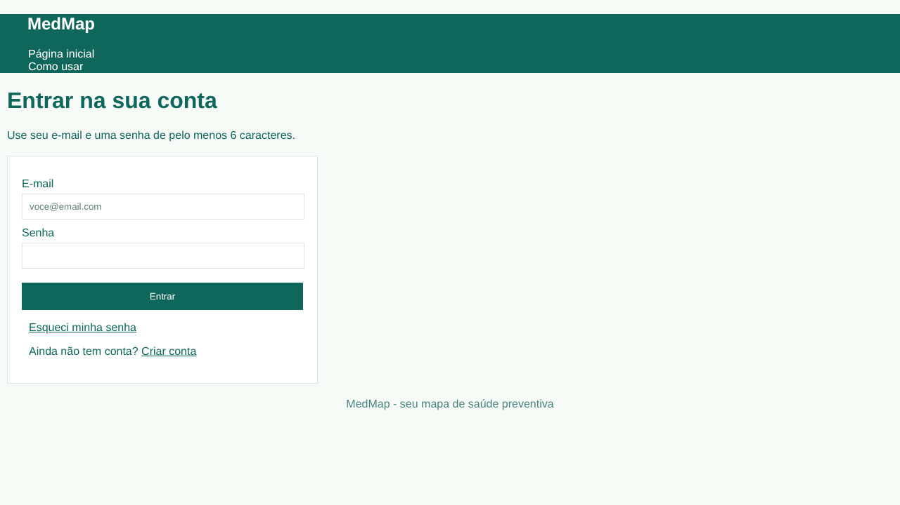
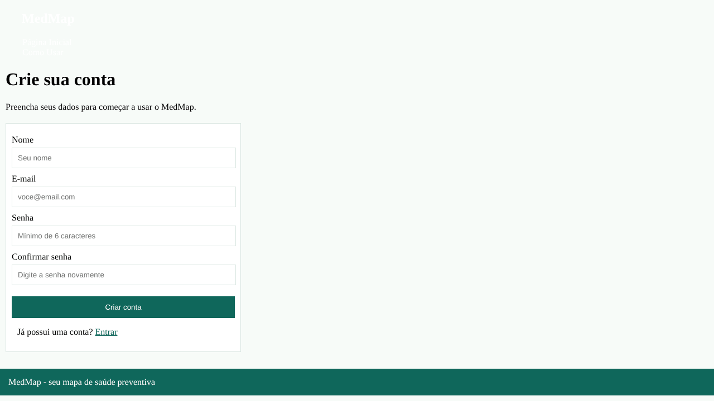
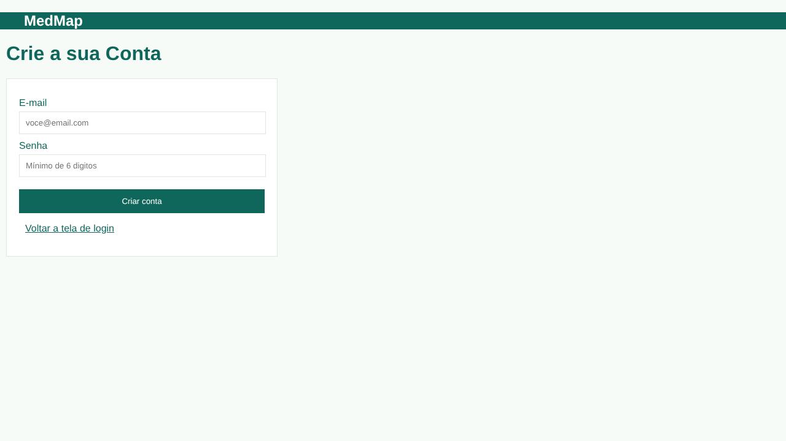
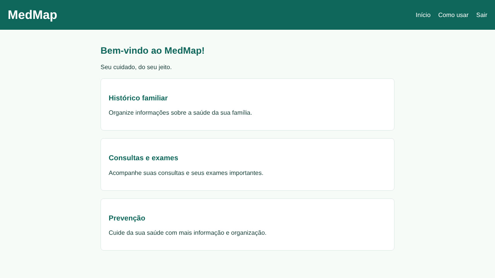
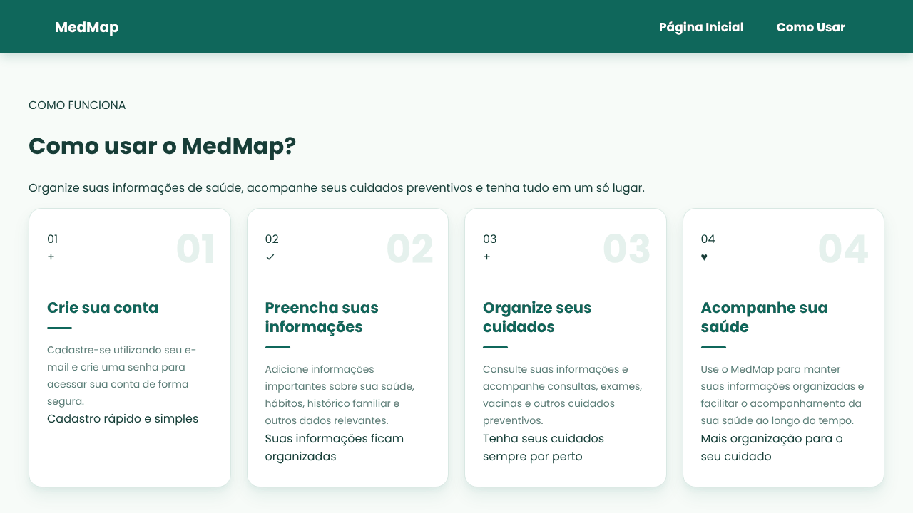
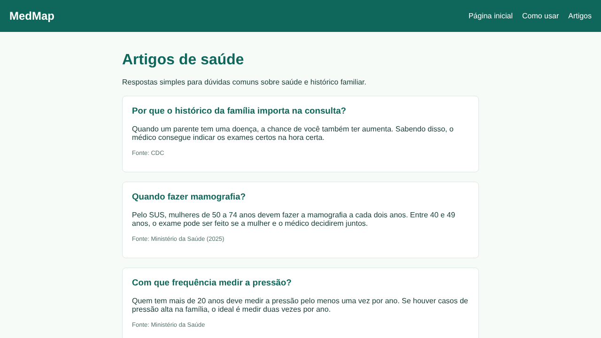
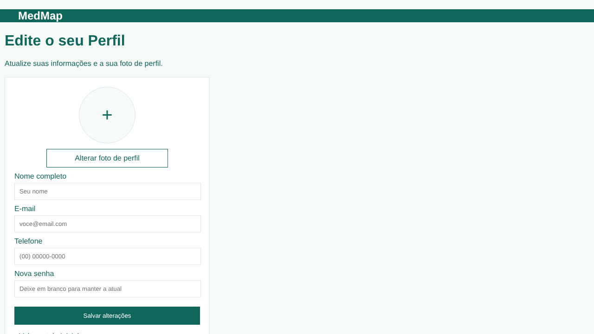
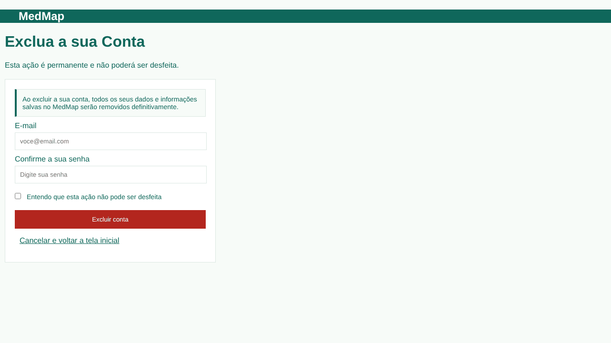
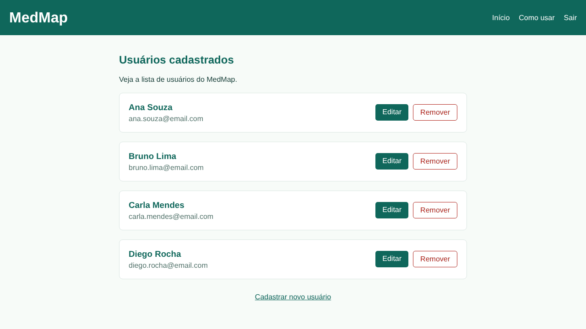

# MedMap

O MedMap é uma aplicação web de saúde preventiva. A pessoa cadastra o seu perfil, o histórico de saúde da família e os seus hábitos, e o MedMap mostra quais consultas, exames e vacinas ela precisa fazer e quando fazer.

Projeto desenvolvido pelo Time 2 (turma 33B) na disciplina ENG4021 - Projeto Integrado, da PUC-Rio.

## Status do projeto

🚧 Em desenvolvimento. As telas já foram feitas em HTML e CSS. A próxima etapa é ligar as telas ao banco de dados com Django.

## Funcionalidades

- Criar conta, entrar na conta e recuperar a senha
- Editar e excluir a conta
- Listar os usuários cadastrados
- Registrar o histórico de saúde da família
- Check-up Inteligente: sugerir consultas, exames e vacinas de acordo com a idade, o sexo, os hábitos e o histórico familiar
- Calendário de cuidados com lembretes
- Página de artigos com dúvidas comuns sobre saúde preventiva

## Tecnologias usadas

- **HTML** e **CSS**: telas do site
- **Python** e **Django**: back-end e banco de dados (em andamento)
- **Figma**: design das telas
- **Lovable**: primeiro protótipo
- **Git** e **GitHub**: controle de versão

## Componentes (telas)

Todas as telas ficam em `ArquivosDeCodigo/TelaDeLogin`, e o CSS de cada uma fica na pasta `css`.

| Tela | Arquivo | O que faz |
| --- | --- | --- |
| Login | `Tela.html` | Entrar na conta com e-mail e senha |
| Criar conta | `CriarConta.html` | Cadastro de um novo usuário |
| Esqueci senha | `EsqueciSenha.html` | Recuperar o acesso à conta |
| Página inicial | `PaginaInicial.html` | Tela de boas-vindas do usuário |
| Como usar | `ComoUsar.html` | Explica como usar o MedMap |
| Artigos | `Artigos.html` | Textos sobre saúde preventiva com fontes oficiais |
| Edição de usuário | `EdicaoUsuario.html` | Alterar os dados da conta |
| Remoção de usuário | `RemocaoUsuario.html` | Excluir a conta |
| Listar usuários | `ListarUsuarios.html` | Mostra os usuários cadastrados, com opções de editar e remover |

## Como usar

1. Entre na tela de **Login**. Se ainda não tiver conta, clique em **Criar conta**.
2. Depois de entrar, você chega na **Página inicial**.
3. Em **Como usar**, você vê o passo a passo do MedMap.
4. Em **Artigos**, você lê respostas simples sobre exames, vacinas e histórico familiar.
5. Para mudar os seus dados ou excluir a conta, use as telas de **Edição** e **Remoção de usuário**.

## Prints das telas

### Login


### Criar conta


### Esqueci senha


### Página inicial


### Como usar


### Artigos


### Edição de usuário


### Remoção de usuário


### Listar usuários


## Como rodar o projeto

Por enquanto, o site é feito só com HTML e CSS, então não precisa instalar nada.

1. Clone o repositório:

```bash
git clone https://github.com/leticiavirgini-png/ENG-4021-Time-2.git
```

2. Abra a pasta `ArquivosDeCodigo/TelaDeLogin`.
3. Abra o arquivo `Tela.html` no navegador (Chrome, Edge ou Firefox).

## Estrutura de pastas

```
ENG-4021-Time-2/
├── ArquivosDeCodigo/
│   └── TelaDeLogin/      # telas do site (HTML)
│       └── css/          # estilo das telas (CSS)
├── Documentos/           # links das atividades de cada sprint
├── Imagens/              # prints das telas usados neste README
└── README.md
```

## Links do projeto

- [Design no Figma](https://www.figma.com/design/hC0vYHw3bqj2FYwUQB0ftd/Figma-time-2-ENG-4021?node-id=0-1&t=hGo2DWpb9pkVvA3d-1)
- [Protótipo no Figma](https://www.figma.com/make/p2kqCzxgwWj3IYYZ3roUE1/MedMap--atualizado-?t=l5wNJmRCFwn9r36C-1)
- [Protótipo no Lovable](https://lovable.dev/projects/603a8d27-59a2-4160-a01c-2c9390db849e)
- [Documento do projeto](https://docs.google.com/document/d/1XEaQMvfLpiWesibYZ-AwQ24oDW-SMko7l49yNKJLPTo/edit)

## Autores

- [Felipe Fraga](https://github.com/ffraga1)
- [Felipe Vasconcelos](https://github.com/felipeavasconcelos-blip)
- [Gael Moraes](https://github.com/gaelmoraess)
- [Letícia Virgini](https://github.com/leticiavirgini-png)
- [Rafaela Ossaille](https://github.com/rafaelaossaille)
- [Thiago Braz](https://github.com/thiagobraz524)
