# MedMap

O MedMap é uma aplicação web de saúde preventiva. Muitas pessoas não sabem quais exames, consultas e vacinas precisam fazer, e o histórico de saúde da família costuma ficar só na memória. No MedMap, a pessoa cadastra o seu perfil, o histórico de saúde da família e os seus hábitos, e a aplicação mostra quais cuidados ela precisa e quando fazê-los.

**Disciplina:** ENG4021 - Projeto Integrado
**Instituição:** PUC-Rio
**Professor:** Alexandre Meslin
**Grupo:** Time 2 (turma 33B)

## Status do projeto

Em desenvolvimento. As telas estão no projeto Django, com uma rota para cada tela, e o banco de dados já foi criado com dados de exemplo. O login, a lista de usuários e o calendário de cuidados já usam os dados do banco. A próxima etapa é ligar as outras telas ao banco.

## Sumário

- [Membros do grupo](#membros-do-grupo)
- [Funcionalidades](#funcionalidades)
- [Tecnologias](#tecnologias)
- [Protótipos](#protótipos)
- [Telas](#telas)
- [Fluxo de uso](#fluxo-de-uso)
- [Arquitetura do projeto](#arquitetura-do-projeto)
- [Como rodar o projeto](#como-rodar-o-projeto)
- [Exemplo de uso](#exemplo-de-uso)
- [Documentação adicional](#documentação-adicional)
- [Melhorias futuras](#melhorias-futuras)
- [Licença](#licença)

## Membros do grupo

| Nome | Função | GitHub |
| --- | --- | --- |
| Felipe Fraga | Desenvolvedor | [ffraga1](https://github.com/ffraga1) |
| Felipe Vasconcelos | Desenvolvedor | [felipeavasconcelos-blip](https://github.com/felipeavasconcelos-blip) |
| Gael Moraes | Desenvolvedor | [gaelmoraess](https://github.com/gaelmoraess) |
| Letícia Virgini | Desenvolvedora | [leticiavirgini-png](https://github.com/leticiavirgini-png) |
| Rafaela Ossaille | Desenvolvedora | [rafaelaossaille](https://github.com/rafaelaossaille) |
| Thiago Braz | Desenvolvedor | [thiagobraz524](https://github.com/thiagobraz524) |

## Funcionalidades

- Entrar na conta com e-mail e senha (já funciona com o banco de dados)
- Listar os usuários cadastrados (já funciona com o banco de dados)
- Calendário de cuidados com os próximos exames, consultas e vacinas (já funciona com o banco de dados)
- Criar conta, recuperar a senha, editar e excluir a conta
- Perfil de saúde, consentimento de dados e preferências de notificações
- Registrar o histórico de saúde da família e os familiares
- Check-up Inteligente: sugerir consultas, exames e vacinas de acordo com a idade, o sexo, os hábitos e o histórico familiar
- Relatório preventivo com o resumo dos cuidados
- Página de artigos com dúvidas comuns sobre saúde preventiva

## Tecnologias

### Linguagens

- **HTML** e **CSS**: telas do site
- **Python**: back-end

### Frameworks e bibliotecas

- **Django**: back-end, rotas das telas e banco de dados

### Ferramentas

- **VS Code**: editor de código
- **Git** e **GitHub**: controle de versão
- **SQLite**: banco de dados do projeto (arquivo `db.sqlite3`)
- **Figma** e **Lovable**: design e protótipos
- **Kanban do Moodle**: organização das tarefas de cada sprint

## Protótipos

- [Design no Figma](https://www.figma.com/design/hC0vYHw3bqj2FYwUQB0ftd/Figma-time-2-ENG-4021?node-id=0-1&t=hGo2DWpb9pkVvA3d-1)
- [Protótipo no Figma](https://www.figma.com/make/p2kqCzxgwWj3IYYZ3roUE1/MedMap--atualizado-?t=l5wNJmRCFwn9r36C-1)
- [Protótipo no Lovable](https://lovable.dev/projects/603a8d27-59a2-4160-a01c-2c9390db849e)

## Telas

As telas ficam em `ArquivosDeCodigo/MeuSite/templates`, e o CSS de cada uma fica em `ArquivosDeCodigo/MeuSite/static/css`.

| Tela | Arquivo | Endereço | O que faz |
| --- | --- | --- | --- |
| Página inicial | `home.html` | `/` | Tela de boas-vindas do usuário |
| Login | `Tela.html` | `/Tela/` | Entrar na conta com e-mail e senha |
| Criar conta | `CriarConta.html` | `/CriarConta/` | Cadastro de um novo usuário |
| Esqueci senha | `EsqueciSenha.html` | `/EsqueciSenha/` | Recuperar o acesso à conta |
| Como usar | `ComoUsar.html` | `/ComoUsar/` | Explica como usar o MedMap |
| Artigos | `Artigos.html` | `/Artigos/` | Textos sobre saúde preventiva com fontes oficiais |
| Edição de usuário | `EdicaoUsuario.html` | `/EdicaoUsuario/` | Alterar os dados da conta |
| Remoção de usuário | `RemocaoUsuario.html` | `/RemocaoUsuario/` | Excluir a conta |
| Listar usuários | `ListarUsuarios.html` | `/ListarUsuarios/` | Mostra os usuários cadastrados no banco, com opções de editar e remover |
| Histórico familiar | `HistoricoFamiliar.html` | `/HistoricoFamiliar/` | Registrar as doenças dos parentes |
| Familiares | `Familiares.html` | `/Familiares/` | Lista dos familiares cadastrados |
| Calendário de cuidados | `CalendarioCuidados.html` | `/CalendarioCuidados/` | Mostra os próximos cuidados do banco, com a data e a situação |
| Perfil de saúde | `PerfilSaude.html` | `/PerfilSaude/` | Informações pessoais e hábitos de saúde |
| Consentimento de dados | `ConsentimentoDados.html` | `/ConsentimentoDados/` | Autorizar o uso dos dados de saúde |
| Preferências de notificações | `PreferenciasNotificacoes.html` | `/PreferenciasNotificacoes/` | Escolher os lembretes que quer receber |
| Check-up Inteligente | `CheckupInteligente.html` | `/CheckupInteligente/` | Cuidados preventivos recomendados |
| Relatório preventivo | `RelatorioPreventivo.html` | `/RelatorioPreventivo/` | Resumo dos cuidados de saúde do usuário |

### Login
Tela de entrada, onde o usuário digita o e-mail e a senha. Os dados são conferidos no banco de dados.

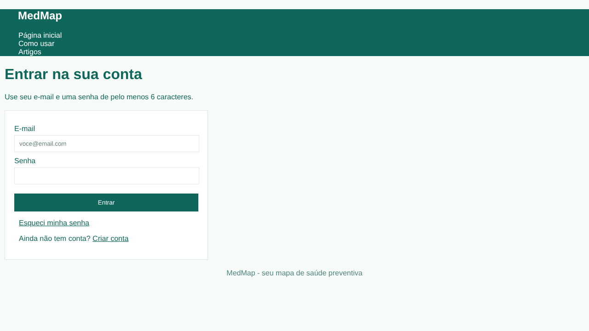

### Criar conta
Formulário de cadastro de um novo usuário.

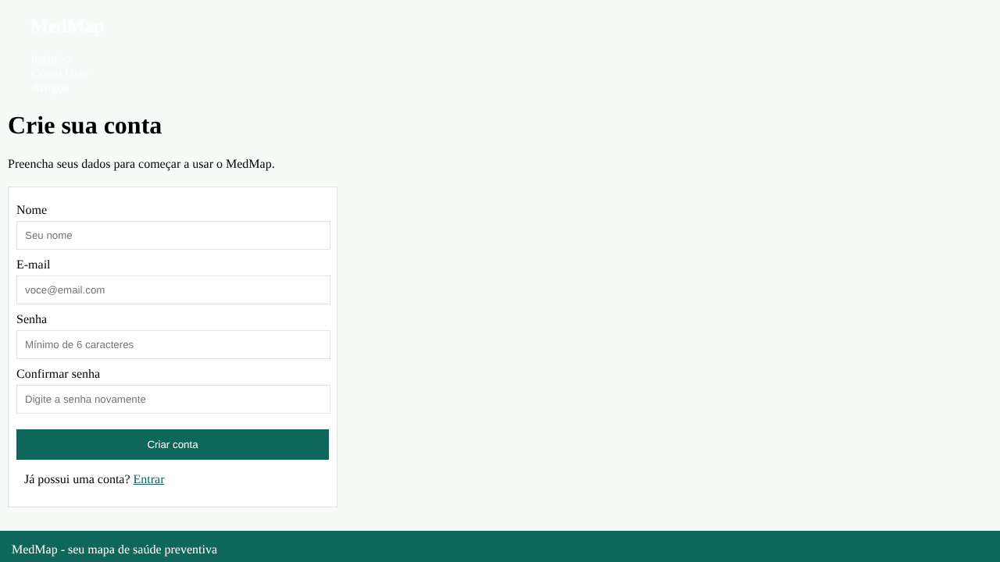

### Esqueci senha
Tela para recuperar o acesso à conta pelo e-mail.

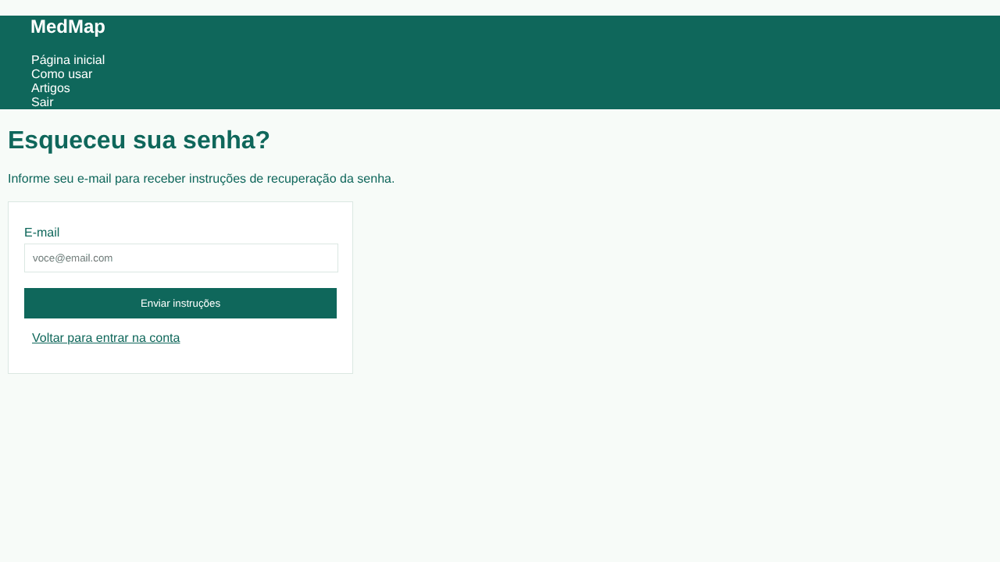

### Página inicial
Tela de boas-vindas, com os principais recursos do MedMap.

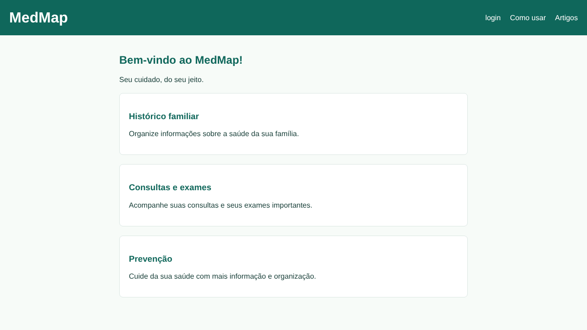

### Como usar
Passo a passo de como usar o MedMap.

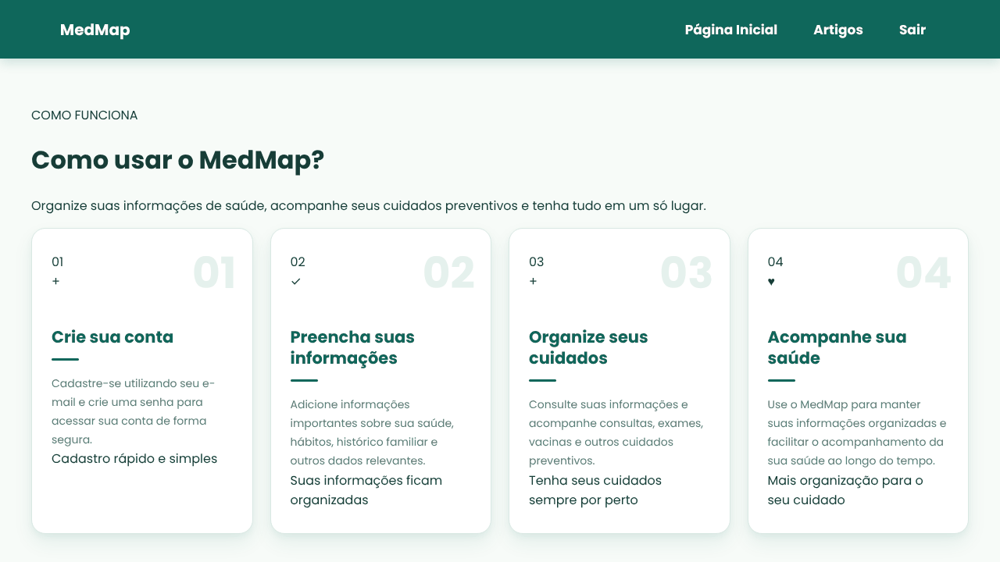

### Artigos
Textos curtos sobre exames, vacinas e histórico familiar, com fontes oficiais.

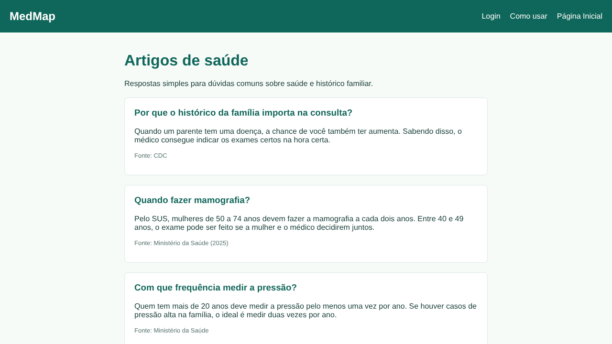

### Edição de usuário
Tela para alterar os dados da conta.

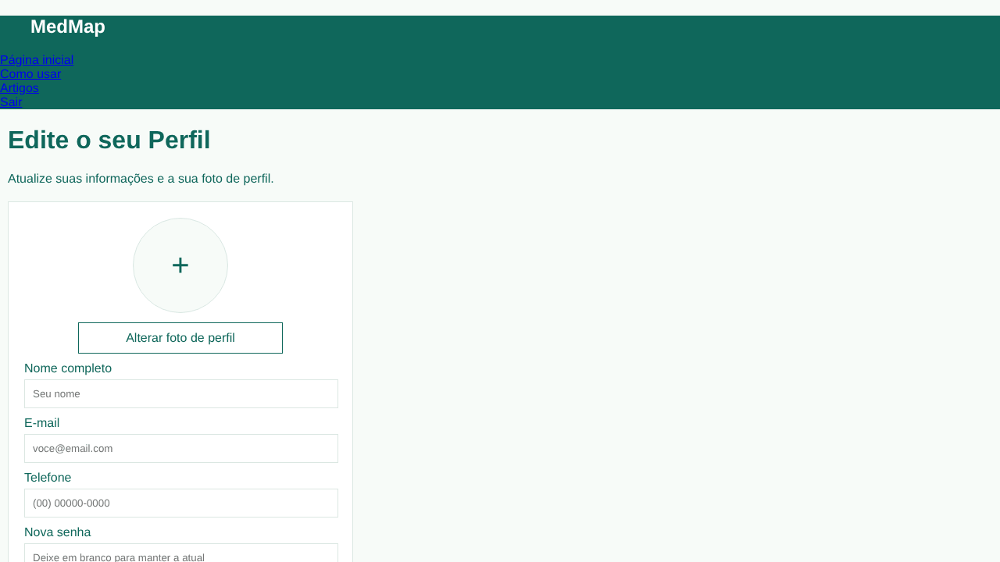

### Remoção de usuário
Tela para excluir a conta, com aviso e confirmação.

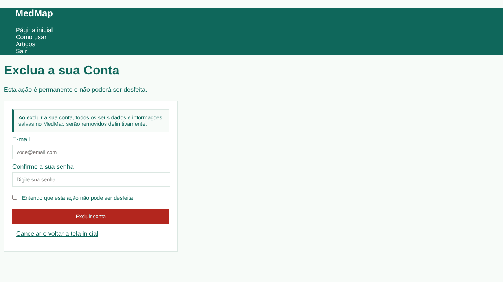

### Listar usuários
Lista dos usuários cadastrados no banco de dados, com botões para editar e remover cada um.

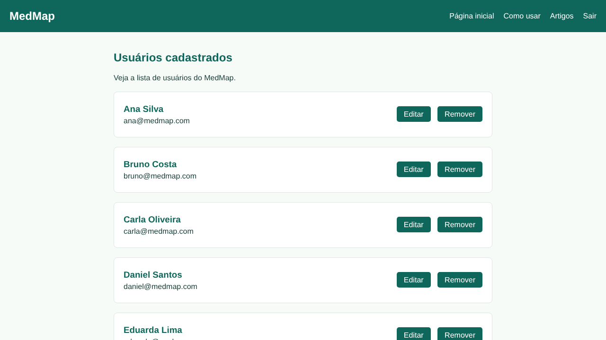

### Histórico familiar
Tela para registrar as doenças dos parentes.

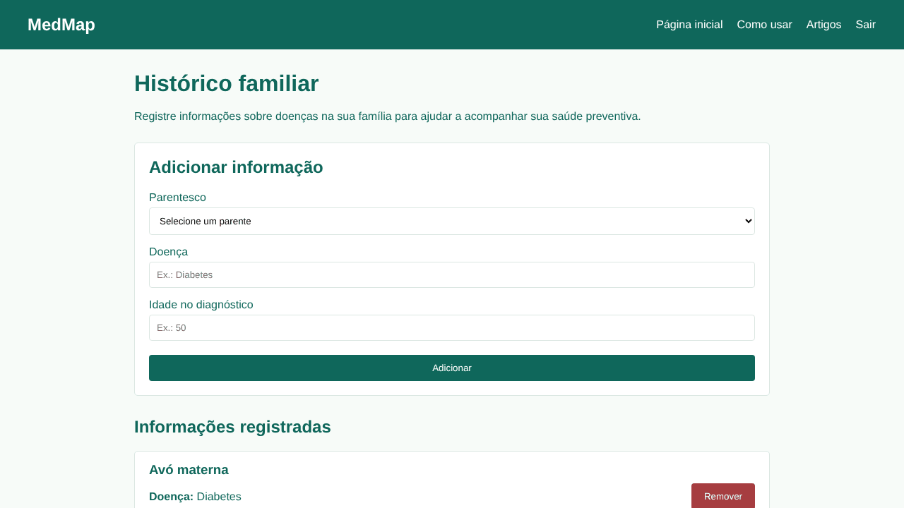

### Calendário de cuidados
Próximos exames, consultas e vacinas, vindos do banco de dados, com a data e a situação de cada um.

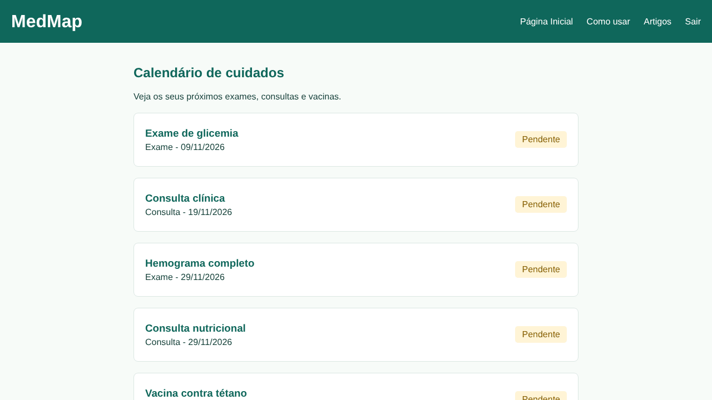

### Perfil de saúde
Formulário com as informações pessoais, os hábitos e os objetivos de saúde.

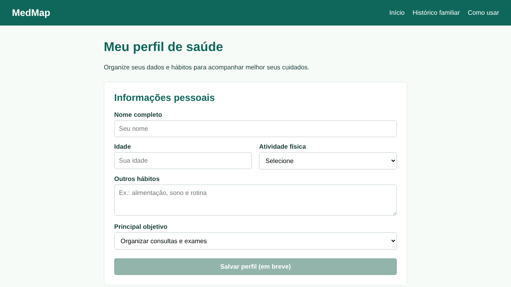

### Consentimento de dados
Explica quais dados de saúde o MedMap usa e pede a autorização do usuário.

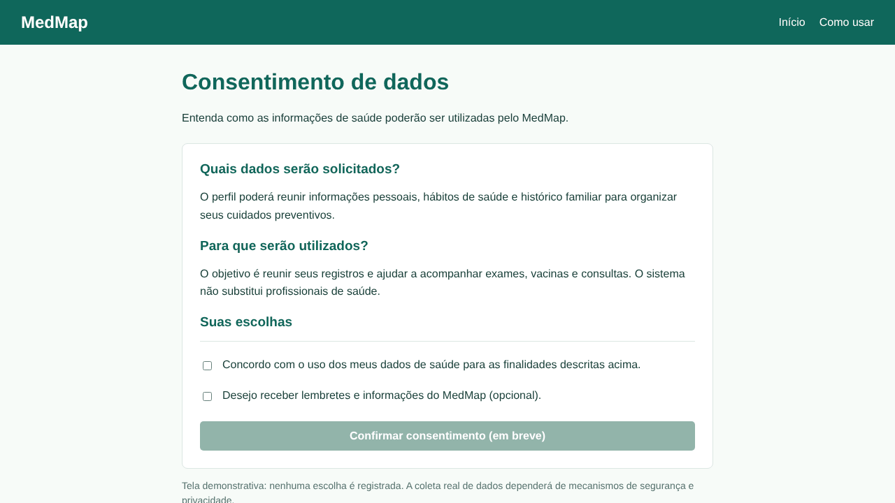

### Preferências de notificações
Escolha dos lembretes e da antecedência dos avisos.

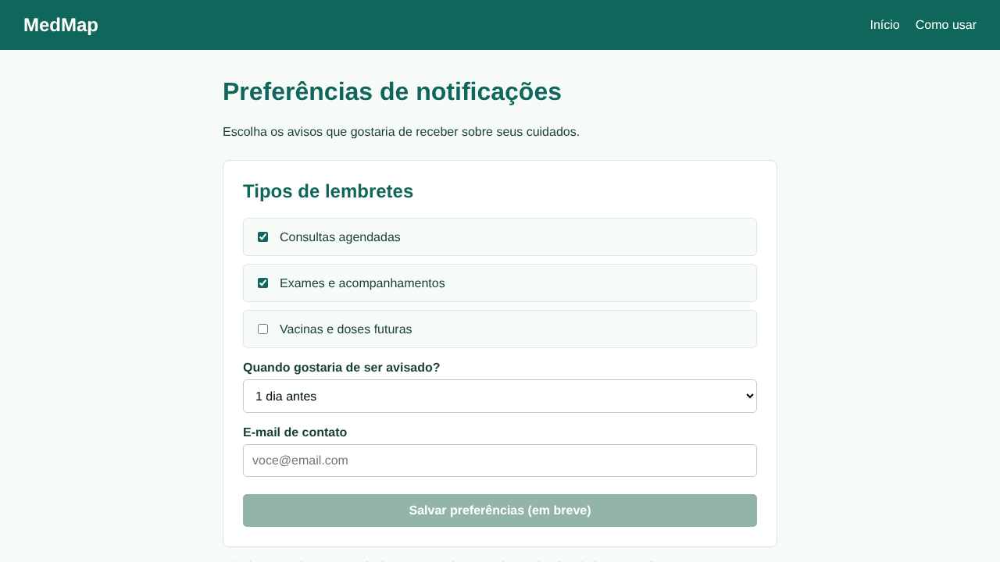

### Check-up Inteligente
Cuidados preventivos recomendados, com a situação de cada um.

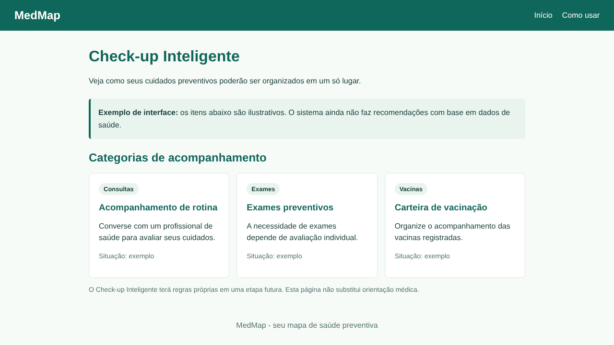

### Relatório preventivo
Resumo dos cuidados de saúde do usuário, com opção de imprimir.

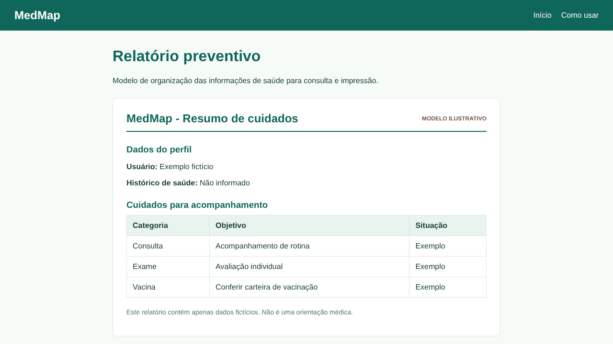

## Fluxo de uso

1. Entre na tela de **Login**. Se ainda não tiver conta, clique em **Criar conta**.
2. Se esquecer a senha, use a tela **Esqueci senha**.
3. Depois de entrar, você chega na **Página inicial**.
4. Preencha o **Perfil de saúde**, o **Consentimento de dados** e o **Histórico familiar**.
5. Veja os cuidados recomendados no **Check-up Inteligente** e as datas no **Calendário de cuidados**.
6. Em **Relatório preventivo**, veja o resumo dos seus cuidados.
7. Em **Como usar** e **Artigos**, leia o passo a passo do MedMap e textos sobre saúde preventiva.
8. Para mudar os seus dados ou excluir a conta, use as telas de **Edição** e **Remoção de usuário**.

## Arquitetura do projeto

O projeto usa Django. As telas em HTML e CSS ficam na pasta de templates, e cada tela tem uma view e uma rota. Os dados ficam no banco de dados SQLite, nas tabelas Usuário, Perfil, Histórico familiar e Cuidado, que seguem a modelagem de dados do projeto.

### Estrutura de pastas

- `ArquivosDeCodigo/manage.py`: arquivo para rodar o projeto Django
- `ArquivosDeCodigo/MeuSite`: configurações, views e rotas (`settings.py`, `views.py`, `urls.py`)
- `ArquivosDeCodigo/MeuSite/templates`: telas do site (HTML)
- `ArquivosDeCodigo/MeuSite/static/css`: estilo das telas (CSS)
- `ArquivosDeCodigo/banco_de_dados`: tabelas do banco de dados (`models.py`)
- `ArquivosDeCodigo/db.sqlite3`: banco de dados com os dados de exemplo
- `ArquivosDeCodigo/popular_banco.py`: arquivo que coloca os dados de exemplo no banco
- `Documentos`: links das atividades de cada sprint
- `Imagens`: prints das telas usados neste README

## Como rodar o projeto

Pré-requisitos: ter o Python, o Git e um navegador instalados.

1. Clone o repositório: `git clone https://github.com/leticiavirgini-png/ENG-4021-Time-2.git`
2. Entre na pasta do projeto: `cd ENG-4021-Time-2/ArquivosDeCodigo`
3. Instale o Django: `pip install -r requirements.txt`
4. Rode o servidor: `python manage.py runserver`
5. Abra `http://127.0.0.1:8000/` no navegador.

O banco de dados já vem com dados de exemplo. Para entrar no site, use o e-mail `ana@medmap.com` e a senha `MedMapDemo123!`. Se precisar recriar os dados de exemplo, rode `python popular_banco.py` dentro da pasta `ArquivosDeCodigo`.

Também dá para rodar pelo GitHub Codespaces, sem instalar nada: no repositório, clique em **Code**, depois em **Codespaces** e em **Create codespace on main**, e siga os passos 2 a 4 no terminal.

## Exemplo de uso

Maria cria uma conta no MedMap e entra no site. Na página **Como usar**, ela vê o que precisa preencher. Depois, lê o artigo sobre mamografia na página **Artigos** e descobre que, pela idade dela, já deve fazer o exame. Se quiser trocar o e-mail, ela usa a tela de **Edição de usuário**.

## Documentação adicional

- [Documento do projeto (Google Docs)](https://docs.google.com/document/d/1XEaQMvfLpiWesibYZ-AwQ24oDW-SMko7l49yNKJLPTo/edit)
- [Modelagem de dados](https://docs.google.com/document/d/1XEaQMvfLpiWesibYZ-AwQ24oDW-SMko7l49yNKJLPTo/edit?tab=t.l9mjjwr8762q)
- Pasta `Documentos/`, com os links das atividades de cada sprint

## Melhorias futuras

- Ligar as outras telas ao banco de dados (criar conta, edição, remoção, perfil e histórico familiar)
- Mostrar no calendário só os cuidados do usuário que entrou na conta
- Fazer o Check-up Inteligente sugerir os cuidados de forma automática
- Enviar lembretes por e-mail
- Permitir vários perfis na mesma conta (por exemplo, pais e filhos)

## Licença

Projeto acadêmico, sem licença definida.
