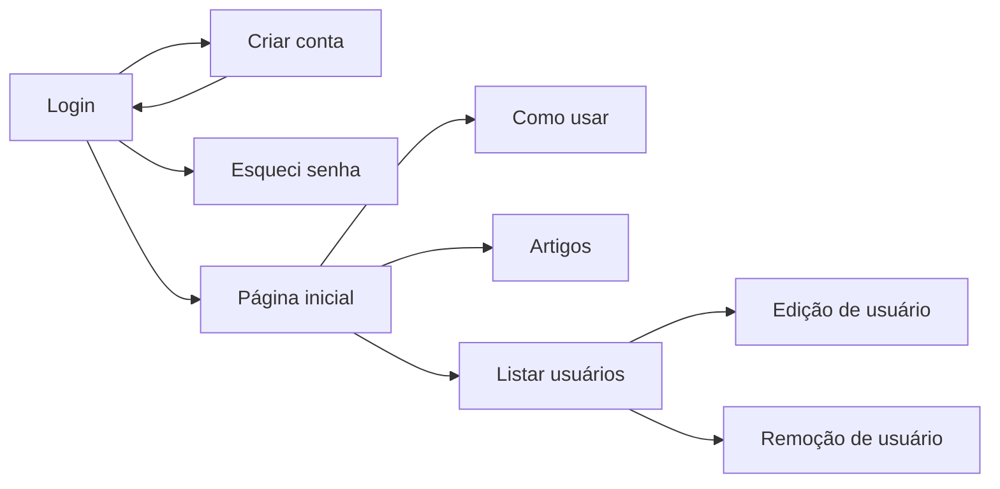
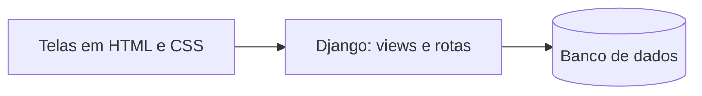

# MedMap

O MedMap é uma aplicação web de saúde preventiva. Muitas pessoas não sabem quais exames, consultas e vacinas precisam fazer, e o histórico de saúde da família costuma ficar só na memória. No MedMap, a pessoa cadastra o seu perfil, o histórico de saúde da família e os seus hábitos, e a aplicação mostra quais cuidados ela precisa e quando fazê-los.

**Disciplina:** ENG4021 - Projeto Integrado
**Instituição:** PUC-Rio
**Professor:** Alexandre Meslin
**Grupo:** Time 2 (turma 33B)

## Status do projeto

Em desenvolvimento. As telas já foram feitas em HTML e CSS. A próxima etapa é ligar as telas ao banco de dados com Django.

## Sumário

- [Membros do grupo](#membros-do-grupo)
- [Funcionalidades](#funcionalidades)
- [Tecnologias](#tecnologias)
- [Protótipos](#protótipos)
- [Telas](#telas)
- [Fluxo de uso](#fluxo-de-uso)
- [Arquitetura do projeto](#arquitetura-do-projeto)
- [Como rodar o projeto](#como-rodar-o-projeto)
- [Exemplo de uso](#exemplo-de-uso)
- [Documentação adicional](#documentação-adicional)
- [Melhorias futuras](#melhorias-futuras)
- [Licença](#licença)

## Membros do grupo

| Nome | Função | GitHub |
| --- | --- | --- |
| Felipe Fraga | Desenvolvedor | [ffraga1](https://github.com/ffraga1) |
| Felipe Vasconcelos | Desenvolvedor | [felipeavasconcelos-blip](https://github.com/felipeavasconcelos-blip) |
| Gael Moraes | Desenvolvedor | [gaelmoraess](https://github.com/gaelmoraess) |
| Letícia Virgini | Desenvolvedora | [leticiavirgini-png](https://github.com/leticiavirgini-png) |
| Rafaela Ossaille | Desenvolvedora | [rafaelaossaille](https://github.com/rafaelaossaille) |
| Thiago Braz | Desenvolvedor | [thiagobraz524](https://github.com/thiagobraz524) |

## Funcionalidades

- Criar conta, entrar na conta e recuperar a senha
- Editar e excluir a conta
- Listar os usuários cadastrados
- Registrar o histórico de saúde da família
- Check-up Inteligente: sugerir consultas, exames e vacinas de acordo com a idade, o sexo, os hábitos e o histórico familiar
- Calendário de cuidados com lembretes
- Página de artigos com dúvidas comuns sobre saúde preventiva

## Tecnologias

### Linguagens

- **HTML** e **CSS**: telas do site
- **Python**: back-end

### Frameworks e bibliotecas

- **Django**: back-end e banco de dados (em andamento)

### Ferramentas

- **VS Code**: editor de código
- **Git** e **GitHub**: controle de versão
- **SQLite**: banco de dados padrão do Django (em andamento)
- **Figma** e **Lovable**: design e protótipos
- **Kanban do Moodle**: organização das tarefas de cada sprint

## Protótipos

- [Design no Figma](https://www.figma.com/design/hC0vYHw3bqj2FYwUQB0ftd/Figma-time-2-ENG-4021?node-id=0-1&t=hGo2DWpb9pkVvA3d-1)
- [Protótipo no Figma](https://www.figma.com/make/p2kqCzxgwWj3IYYZ3roUE1/MedMap--atualizado-?t=l5wNJmRCFwn9r36C-1)
- [Protótipo no Lovable](https://lovable.dev/projects/603a8d27-59a2-4160-a01c-2c9390db849e)

## Telas

Todas as telas ficam em `ArquivosDeCodigo/TelaDeLogin`, e o CSS de cada uma fica na pasta `css`.

| Tela | Arquivo | O que faz |
| --- | --- | --- |
| Login | `Tela.html` | Entrar na conta com e-mail e senha |
| Criar conta | `CriarConta.html` | Cadastro de um novo usuário |
| Esqueci senha | `EsqueciSenha.html` | Recuperar o acesso à conta |
| Página inicial | `PaginaInicial.html` | Tela de boas-vindas do usuário |
| Como usar | `ComoUsar.html` | Explica como usar o MedMap |
| Artigos | `Artigos.html` | Textos sobre saúde preventiva com fontes oficiais |
| Edição de usuário | `EdicaoUsuario.html` | Alterar os dados da conta |
| Remoção de usuário | `RemocaoUsuario.html` | Excluir a conta |
| Listar usuários | `ListarUsuarios.html` | Mostra os usuários cadastrados, com opções de editar e remover |

### Login
Tela de entrada, onde o usuário digita o e-mail e a senha.

### Criar conta
Formulário de cadastro de um novo usuário.

### Esqueci senha
Tela para recuperar o acesso à conta pelo e-mail.

### Página inicial
Tela de boas-vindas, com os principais recursos do MedMap.

### Como usar
Passo a passo de como usar o MedMap.

### Artigos
Textos curtos sobre exames, vacinas e histórico familiar, com fontes oficiais.

### Edição de usuário
Tela para alterar os dados da conta.

### Remoção de usuário
Tela para excluir a conta, com aviso e confirmação.

### Listar usuários
Lista dos usuários cadastrados, com botões para editar e remover cada um.

## Fluxo de uso

1. Entre na tela de **Login**. Se ainda não tiver conta, clique em **Criar conta**.
2. Se esquecer a senha, use a tela **Esqueci senha**.
3. Depois de entrar, você chega na **Página inicial**.
4. Em **Como usar**, você vê o passo a passo do MedMap.
5. Em **Artigos**, você lê respostas simples sobre exames, vacinas e histórico familiar.
6. Para mudar os seus dados ou excluir a conta, use as telas de **Edição** e **Remoção de usuário**.

## Arquitetura do projeto

Hoje o projeto tem só o front-end (HTML e CSS). Com o Django, as telas vão virar templates e os dados vão ficar no banco de dados.

### Estrutura de pastas

- `ArquivosDeCodigo/TelaDeLogin`: telas do site (HTML)
- `ArquivosDeCodigo/TelaDeLogin/css`: estilo das telas (CSS)
- `Documentos`: links das atividades de cada sprint
- `Imagens`: prints das telas usados neste README

## Como rodar o projeto

Pré-requisitos: ter um navegador e o Git instalados.

1. Clone o repositório: `git clone https://github.com/leticiavirgini-png/ENG-4021-Time-2.git`
2. Abra a pasta `ArquivosDeCodigo/TelaDeLogin`.
3. Abra o arquivo `Tela.html` no navegador.

Não é preciso nenhuma configuração específica, porque o site ainda é só HTML e CSS.

## Exemplo de uso

Maria cria uma conta no MedMap e entra no site. Na página **Como usar**, ela vê o que precisa preencher. Depois, lê o artigo sobre mamografia na página **Artigos** e descobre que, pela idade dela, já deve fazer o exame. Se quiser trocar o e-mail, ela usa a tela de **Edição de usuário**.

## Documentação adicional

- [Documento do projeto (Google Docs)](https://docs.google.com/document/d/1XEaQMvfLpiWesibYZ-AwQ24oDW-SMko7l49yNKJLPTo/edit)
- [Modelagem de dados](https://docs.google.com/document/d/1XEaQMvfLpiWesibYZ-AwQ24oDW-SMko7l49yNKJLPTo/edit?tab=t.l9mjjwr8762q)
- Pasta `Documentos/`, com os links das atividades de cada sprint

## Melhorias futuras

- Ligar as telas ao banco de dados com Django
- Criar o perfil de saúde e o histórico familiar
- Criar o Check-up Inteligente e o calendário de cuidados
- Enviar lembretes por e-mail
- Permitir vários perfis na mesma conta (por exemplo, pais e filhos)

## Licença

Projeto acadêmico, sem licença definida.
